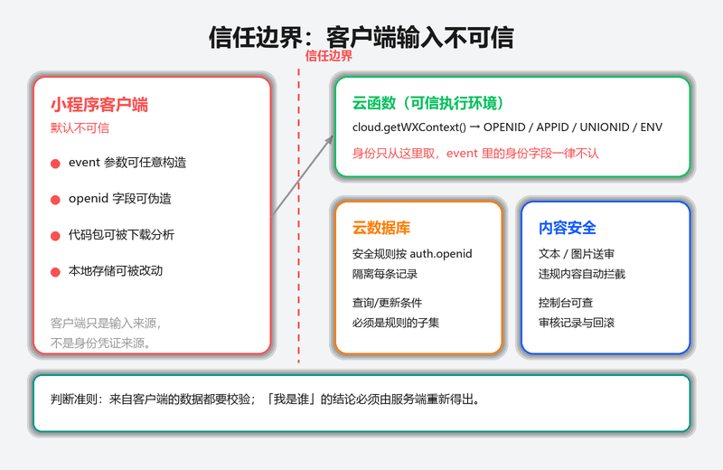

# 安全加固：守住信任边界

## 为什么读这篇

小程序上线后，第一类真实事故往往不是「功能没做完」，而是「把客户端传来的数据当成了事实」：有人改一个 `openid` 就能看别人的订单，有人绕过按钮直接调云函数，有人把违规文本写进数据库，触发内容安全重写或审核处罚。这篇不讲空泛的安全口号，只讲小程序云开发里最关键的四个落点：身份、云函数、数据库、内容。读完你应该能画出自己项目的信任边界，并把它变成控制台里的规则和云函数里的校验。

前置知识：已读完[云开发入门](../04-云开发/01-云开发入门.md)、[云函数](../04-云开发/02-云函数.md)与[云数据库](../04-云开发/03-云数据库.md)，知道 `wx.cloud.callFunction` 与 `cloud.getWXContext()` 的基本用法。

## 一、先画信任边界：客户端默认不可信

安全设计的第一步不是写代码，而是回答一个问题：**哪些数据来自不可信区域，哪些结论必须由可信区域重新得出？**



官方[开发安全指引](https://developers.weixin.qq.com/miniprogram/security/basic/)把原则写得很直接：

1. **互不信任原则**：不要信任用户提交的数据，必要的数据校验必须放在后台。
2. **最小权限原则**：代码、模块只拥有完成任务所需的最小权限。
3. **重要业务逻辑放后台**：小程序代码可被外部获取及反混淆，不能把关键判断只放在客户端。
4. **身份鉴权**：后台接口调用与云函数调用必须做有效身份鉴权。

把这四条翻译成小程序的语言：**客户端是输入来源，不是身份凭证来源；云函数是可信执行环境，但云函数内部也要自己做业务授权；数据库规则是粗筛，不是万能锁。**

## 二、身份：只认 `getWXContext()`，不认 `event.openid`

云函数里拿用户身份只有一个正确入口：`cloud.getWXContext()`。它返回 `OPENID`、`APPID`、`UNIONID`、`ENV` 等字段，其中 `OPENID` 由微信运行时注入，小程序端无法伪造。这个 API 只能在云函数中调用，并且要在 `exports.main` 内执行；小程序端没有它。边界是：如果云函数由定时触发器、控制台测试或非小程序端调用，`OPENID` 可能为空；涉及用户身份的操作要先拒绝空身份，不能把空值当成合法用户。

下面是一个完整的云函数 `index.js`，把身份信息原样返回，方便你在真机上验证「客户端传什么都不会改变 `OPENID`」：

*代码状态：可运行（云函数 index.js）*

```js
const cloud = require('wx-server-sdk');

cloud.init({ env: cloud.DYNAMIC_CURRENT_ENV });

exports.main = async (event) => {
  const { OPENID, APPID, UNIONID, ENV } = cloud.getWXContext();

  return {
    openid: OPENID,
    appid: APPID,
    unionid: UNIONID,
    env: ENV,
    receivedKeys: Object.keys(event || {}),
  };
};
```

部署后，在小程序端故意传一个假的 `openid` 调用它：

*代码状态：片段（小程序端调用示例）*

```js
wx.cloud.callFunction({
  name: 'whoami',
  data: { openid: 'fake_openid' },
}).then(({ result }) => {
  console.log('真实 openid：', result.openid);
  console.log('客户端传的键：', result.receivedKeys);
});
```

你会看到 `receivedKeys` 里有 `openid`，但返回的 `result.openid` 仍然是当前用户的真实 `OPENID`。这正是云开发身份模型的根基：**客户端可以随便构造 `event`，但构造不了 `getWXContext()`。**

反例是把 `event` 里的身份字段当成事实：

*代码状态：反例（信任客户端身份）*

```js
exports.main = async (event) => {
  const { openid } = event;
  return db.collection('orders').where({ _openid: openid }).get();
};
```

这段代码有两个致命问题：字段名写成了小写 `openid`，真实上下文里根本没有这个字段；即使写成 `event.OPENID`，攻击者也能在请求里塞任意值。**身份字段只能来自 `getWXContext()`，`event` 里的同名字段最多当普通输入校验，绝不能当身份凭证。**

## 三、云函数：默认拒绝，显式放行

身份解决了「你是谁」，云函数安全规则解决「谁能调用这个函数」。官方文档给出的默认规则是：

*代码状态：可运行（粘贴到云函数安全规则配置）*

```json
{
  "*": {
    "invoke": "auth != null"
  }
}
```

这条规则的含义是：所有云函数默认只允许有登录态的用户调用。它约束的是小程序端发起的调用；函数之间的调用、控制台调用与 HTTP 触发不走这条规则，所以业务权限仍要在函数内部判断。云函数安全规则支持三种典型写法：

表：云函数安全规则的常见配置与风险

| 配置 | 含义 | 风险与建议 |
|---|---|---|
| `"*": {"invoke": "auth != null"}` | 所有函数默认要求登录态 | 基线配置；未登录模式下 `auth == null`，会被拒绝 |
| `"function1": {"invoke": "auth != null"}` | 指定函数覆盖通配符，要求登录态 | 登录不等于有业务权限，函数内部还要做业务校验 |
| `"function1": {"invoke": true}` | 指定函数允许所有来源调用，包括未登录用户 | 只给确实公开的入口用；公开入口更要做参数校验与限流 |

两个容易踩的边界：

- **具体函数规则优先于通配符**。你可以在 `"*"` 里统一要求登录，再对某个公开函数单独写 `true`。
- **`invoke` 只管「能不能调」，不管「调了能做什么」**。一个登录用户可以调用你的函数，不代表他有权删除别人的数据。业务权限必须在函数内部用 `getWXContext()` 重新判断。

因此，云函数里至少要有一层「资源归属校验」：

*代码状态：片段（云函数内做业务授权）*

```js
const { OPENID } = cloud.getWXContext();

const result = await db.collection('orders').where({
  _id: event.orderId,
  _openid: OPENID,
}).get();

if (!result.data.length) {
  return { ok: false, error: 'ORDER_NOT_FOUND_OR_FORBIDDEN' };
}
```

注意这里没有先查再比较 `_openid`，而是把归属条件直接放进查询条件。这样既避免了先查出他人数据再判断的漏判，也让归属校验与读取发生在同一条数据库查询里。

## 四、数据库：规则只做粗筛，查询必须自证

云数据库的自定义安全规则，是比四种预设权限更细的控制方式。官方示例：

*代码状态：可运行（粘贴到集合的自定义安全规则）*

```json
{
  "read": "doc._openid == auth.openid",
  "write": "doc._openid == auth.openid"
}
```

这条规则的含义是：只能读、写 `_openid` 等于当前用户 `openid` 的记录。安全规则支持 `read`、`write`、`create`、`update`、`delete` 等操作类型，内置 `auth`、`doc`、`now` 三个变量。`create` 会校验写入的数据是否符合规则，`read`、`update`、`delete` 则会把查询条件与规则做匹配。

关键机制在这里：**对于查询或更新操作，输入的查询条件必须是安全规则的子集。系统不会先取数据再逐条过滤，而是直接判断你的查询条件是否落在规则允许的范围内。**这解释了为什么很多「旧代码能跑、开了安全规则就报错」：

*代码状态：反例（旧权限写法，在自定义安全规则下不满足子集要求）*

```js
db.collection('todo').doc('x').get();
```

`doc('x')` 只指定了 `_id`，查询条件里没有 `_openid`，系统无法判断它是否是 `doc._openid == auth.openid` 的子集，因此会直接拒绝。正确写法是把归属条件显式放进 `where`：

*代码状态：片段（满足安全规则的查询）*

```js
db.collection('todo').where({
  _id: 'x',
  _openid: '{openid}',
}).get();
```

`{openid}` 是安全规则体系里的特殊字符串常量，后台会自动替换为当前用户的真实 `openid`。`doc.update` 与 `doc.remove` 同理；但 **`doc.set` 无法使用这种写法，需要改用 `doc.update`**。

还有两个边界必须记住：

- **云函数操作数据库不受集合权限限制**。云函数以管理员身份执行，能跨用户读写。这是设计使然：服务端逻辑需要跨用户能力，所以安全责任也转移到了云函数代码里。前面那段「把 `_openid: OPENID` 放进查询条件」的代码，就是云函数里的必要动作。
- **规则不是业务规则**。安全规则能表达「只能操作自己的记录」，但很难表达「只有 VIP 用户能退款」「订单状态必须是已支付才能发货」。这类业务授权仍然要写在云函数里。

## 五、内容安全：把审核放在写入口

小程序提审和线上运营都会检查违规内容。微信云开发提供内容安全能力：进入云开发控制台，点击「更多」→「内容安全」开通，然后按集合与字段配置规则。字段命中违规后，内容会被自动改写为预设的重写内容，默认是「该内容已违规暂不展示」；每次插入、更新都会触发审核并产生审核记录，如果重写结果不符合预期，可以在审核详情里回滚该字段。

这条链路的价值在于：**审核发生在数据写入时，而不是等用户举报后再处理。**对评论、昵称、商品描述这类 UGC 字段，应该在控制台为对应集合字段配置规则，而不是只靠前端做关键词过滤。前端过滤只能挡住普通用户，挡不住直接调接口的人。

内容安全不是「开了就万事大吉」：它按字段生效，新增集合或新增字段时要记得补配置；它只处理配置过的字段，不会自动覆盖你所有的文本入口。上线前把「哪些字段会被用户直接写入」列一遍，再逐个核对是否配置了规则。

## 六、上线前安全清单

表：小程序上线前的安全核对清单

| 检查项 | 合格标准 | 失败后果 |
|---|---|---|
| 身份来源 | 云函数只从 `getWXContext()` 取 `OPENID`，不读 `event.openid` | 任意用户可伪造身份，越权读写 |
| 云函数规则 | 默认 `auth != null`；公开函数逐个评估 `invoke: true` | 未登录用户可调用内部函数 |
| 业务授权 | 每次读写都带 `_openid` 或等价的归属条件 | 登录用户可以操作他人数据 |
| 数据库规则 | 自定义规则与查询条件匹配，避免 `doc()` 旧写法 | 规则上线后接口大面积报错，或隔离失效 |
| 内容安全 | 所有 UGC 写入口都配置了字段规则 | 违规内容进入线上，提审失败或被处罚 |
| 敏感配置 | AppSecret、第三方密钥不写进小程序代码 | 代码包被反混淆后密钥泄露 |

这张表建议直接贴进发布检查单：每次发版前逐项打勾，而不是等出事后再回忆「当时规则是怎么配的」。

## 常见错误 / 避坑

1. **相信 `event.openid`**：客户端传什么，`event` 里就有什么。身份必须从 `getWXContext()` 取，字段名是 `OPENID`，不是 `openid`。
2. **为了让未登录用户能调用，把云函数规则改成 `invoke: true`**：这会让所有来源都能调用，包括恶意请求。公开入口应该单独列出，并在函数内部做参数校验、频率限制与业务授权。
3. **开了自定义安全规则，却继续用 `doc('x').get()`**：查询条件不满足规则子集，会被直接拒绝。改成 `where({ _id, _openid: '{openid}' })`，`doc.set` 改用 `doc.update`。
4. **以为云函数不受数据库规则限制就安全**：云函数是管理员身份，越权能力更大。每条云函数数据库操作都要自己带归属条件，不能依赖集合权限兜底。
5. **只在前端过滤违规词**：前端过滤可被绕过，UGC 字段要在控制台配置内容安全规则，让审核发生在写入口。

## 随堂测验

**Q1**: 小程序端调用云函数时传入 `data: { openid: 'fake_openid' }`，云函数里 `cloud.getWXContext().OPENID` 的值是什么？
- [ ] A. `fake_openid`，因为客户端传了这个值
- [ ] B. 当前用户的真实 `OPENID`，由微信运行时注入
- [ ] C. `undefined`，因为字段名大小写不一致
- [ ] D. 随机值，每次调用都不同

<details><summary>答案</summary>

**B**. `getWXContext()` 的 `OPENID` 由微信运行时注入，与客户端 `event` 里的同名字段无关，参见[身份](#二身份只认-getwxcontext不认-eventopenid)。

</details>

**Q2**: 云函数安全规则里把某个函数配置成 `"invoke": true`，最直接的风险是什么？
- [ ] A. 该函数无法被登录用户调用
- [ ] B. 该函数允许所有来源调用，包括未登录用户
- [ ] C. 该函数的数据库权限被自动放开
- [ ] D. 该函数的代码会被下载到客户端

<details><summary>答案</summary>

**B**. `invoke` 控制调用权限，`true` 表示允许所有来源调用，包括未登录用户；它不会改变数据库权限，参见[云函数安全规则](#三云函数默认拒绝显式放行)。

</details>

**Q3**: 集合 `todo` 配置了 `"read": "doc._openid == auth.openid"`，下面哪种查询最可能满足安全规则的子集要求？
- [ ] A. `db.collection('todo').doc('x').get()`
- [ ] B. `db.collection('todo').where({ _id: 'x' }).get()`
- [ ] C. `db.collection('todo').where({ _id: 'x', _openid: '{openid}' }).get()`
- [ ] D. `db.collection('todo').where({ done: false }).get()`

<details><summary>答案</summary>

**C**. 查询条件里显式带上了 `_openid: '{openid}'`，后台会替换为当前用户 `openid`，满足规则子集；只写 `_id` 或只写业务字段都无法证明归属，参见[数据库](#四数据库规则只做粗筛查询必须自证)。

</details>

**Q4**: 云函数以管理员身份操作云数据库，集合权限设成「仅管理端可读写」。此时云函数查询订单时最应该做什么？
- [ ] A. 什么都不用做，管理员身份天然安全
- [ ] B. 只要客户端传了 `openid` 就可以直接使用
- [ ] C. 用 `getWXContext().OPENID` 作为归属条件写进查询
- [ ] D. 把集合权限改成「所有人可读」以简化查询

<details><summary>答案</summary>

**C**. 云函数不受集合权限限制，越权能力更大，所以每次数据库操作都要自己带 `_openid` 归属条件，参见[数据库规则的两个边界](#四数据库规则只做粗筛查询必须自证)。

</details>

## 验证

- [ ] 画出自己项目的信任边界图，标出客户端、云函数、云数据库、内容安全四个位置
- [ ] 在云函数里打印 `cloud.getWXContext()`，确认返回字段是大写 `OPENID`
- [ ] 在小程序端故意传 `data: { openid: 'fake' }`，确认云函数返回的仍是真实身份
- [ ] 检查云函数安全规则：默认是否为 `auth != null`，是否有人为了省事改成了 `true`
- [ ] 检查数据库自定义规则与查询代码，确认没有 `doc('x').get()` 这类旧写法
- [ ] 列出所有 UGC 写入口，逐一核对内容安全字段规则

## 延伸阅读

- 本库上一篇：[商品列表实战](../06-实战/03-商品列表实战.md)
- 本库下一篇：[线上排障与应急](./02-线上排障与应急.md)
- 本库：[云开发入门](../04-云开发/01-云开发入门.md)（`getWXContext()` 身份模型）
- 本库：[云函数](../04-云开发/02-云函数.md)（函数入口与调用链）
- 本库：[云数据库](../04-云开发/03-云数据库.md)（权限模式与安全边界）
- 官方：[开发安全指引](https://developers.weixin.qq.com/miniprogram/security/basic/)
- 官方：[云函数安全规则](https://developers.weixin.qq.com/miniprogram/dev/wxcloudservice/wxcloud/guide/functions/security-rules.html)
- 官方：[数据库安全规则](https://developers.weixin.qq.com/miniprogram/dev/wxcloudservice/wxcloud/guide/database/security-rules.html)
- 官方：[`cloud.getWXContext()`](https://developers.weixin.qq.com/miniprogram/dev/wxcloudservice/wxcloud/reference-sdk-api/utils/Cloud.getWXContext.html)
- 官方：[内容安全](https://developers.weixin.qq.com/miniprogram/dev/wxcloudservice/wxcloud/basis/Consecurity.html)
