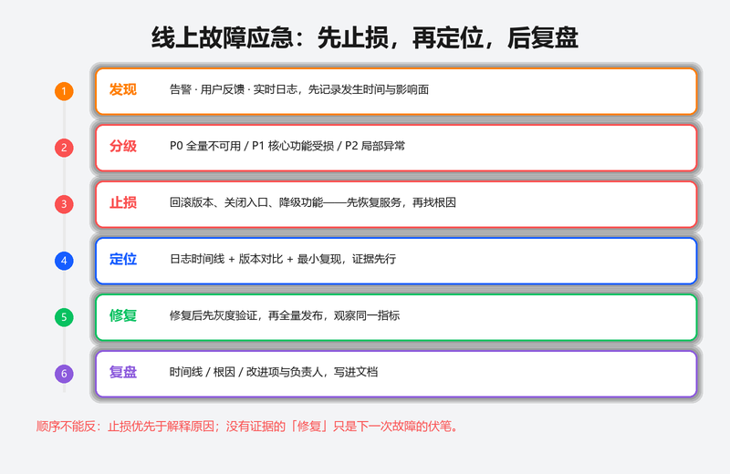

# 线上排障与应急

## 为什么读这篇

上线之后，故障不是「会不会发生」，而是「什么时候发生」。真正拉开差距的不是谁更会改代码，而是谁能在压力下按顺序做对事：先确认影响面，再止损，再拿证据定位，最后复盘。很多团队把顺序做反了——先猜原因、先改代码、先争论责任，结果故障时间被拉长，现场证据也丢了。这篇给你一套能直接用的流程：日志怎么留、故障怎么分级、版本怎么回、复盘怎么写。

前置知识：已经完成一次真实发布，读过[上线发布](../05-发布/01-上线发布.md)，并了解[云函数](../04-云开发/02-云函数.md)与[调试与排错](../03-进阶/11-调试与排错.md)里的基本工具。

## 一、先分级，再动手



线上出问题时，最危险的不是你不知道原因，而是所有人同时开始「试试看」。先做三件事：

1. **确认影响面**：多少用户受影响？核心链路是否中断？是否涉及资金、隐私或数据一致性？
2. **定一个负责人**：一个人统一决策与对外沟通，其他人只提供证据，不并行改动生产环境。
3. **记录时间线**：从第一个告警或用户反馈开始记，后面复盘全靠它。

表：建议的故障分级（团队可按业务调整）

| 等级 | 判定标准 | 首动作 | 建议目标 |
|---|---|---|---|
| P0 | 全量用户无法进入，或核心交易链路中断 | 立即止损：回滚、关闭入口或降级 | 尽快恢复可用入口 |
| P1 | 核心功能受损，但存在替代路径 | 降级 + 定位，必要时回滚 | 尽快给出明确结论 |
| P2 | 局部用户或非核心功能异常 | 记录证据，按正常排期修复 | 当日处理并回访 |

分级不是为了写报告，而是为了决定「先做什么」。P0 场景下，先把服务恢复，再慢慢找根因；P2 场景下，可以先保留现场、在测试环境复现。**没有分级，就没有优先级；没有优先级，所有人都在做自己认为最急的事。**

头 10 分钟的建议动作：

- 前 2 分钟：记录故障开始时间、影响面、最近一次变更（版本、云函数、配置、数据库规则）。
- 接下来 3 分钟：按上表定级，指定负责人与沟通渠道。
- 第 5 到 10 分钟：执行止损动作，同时保留日志、截图与请求样本，不要急着重启或清空现场。

## 二、证据从哪来：把日志变成时间线

排障不是猜谜。你需要的是能回答「什么时候、哪个版本、哪个用户、发生了什么」的证据。小程序云开发至少有三种证据来源。

### 云函数高级日志

云开发的日志服务可以采集和检索云函数日志，每条日志最长存储 30 天，超过 30 天会被自动清理。使用前需要：

- 开发者工具版本不低于 1.02.1910242；
- `wx-server-sdk` 版本不低于 1.5.0；
- 在云开发控制台的云函数高级日志界面开启服务。日志服务在基础套餐外额外收费，是否开启要结合业务量评估。

打日志用 `cloud.logger()`，并且必须放在 `exports.main` 里，否则不会生效：

*代码状态：可运行（云函数 index.js）*

```js
const cloud = require('wx-server-sdk');

cloud.init({ env: cloud.DYNAMIC_CURRENT_ENV });

exports.main = async (event) => {
  const log = cloud.logger();

  log.info({
    event: 'order.create',
    orderId: event.orderId,
    result: 'received',
  });

  return { ok: true };
};
```

`logger()` 返回的对象上有 `log`、`info`、`warn`、`error` 四个等级的方法，传入一个对象，每个键值对都会成为可检索字段，值会被转成字符串。检索时可以按 `level`、`function`、`requestId` 等字段快速过滤，其中 `requestId` 由平台注入。不要在日志里写明文 `openid`、手机号、地址或用户填写的正文；日志是排障工具，不是敏感数据的仓库。

### 实时日志

小程序端的实时日志适合记录「用户侧发生了什么」。基础库 2.7.1 起支持 `wx.getRealtimeLogManager()`，小程序插件需要基础库 2.16.0 及以上。日志会汇聚到小程序后台，你可以从 `We分析 → 性能质量 → 实时日志 → 小程序日志` 进入查询页面。

*代码状态：片段（页面逻辑）*

```js
const log = wx.getRealtimeLogManager();

Page({
  onLoad(options) {
    log.info('page:detail', { id: options.id });
  },
  onShow() {
    log.info('page:detail:show');
  },
});
```

实时日志的关键边界是**抽样**：正式版默认不是全量记录，采样率以后台配置为准。因此它能帮你找到「有用户遇到了这个错」的现场，但不能用来做精确的故障率统计。需要精确计数时，用你自己的埋点或云函数日志。

### 版本与发布记录

很多线上问题不是代码「突然坏了」，而是「某个变更刚刚生效」。排障时至少对齐三样记录：

- 小程序线上版本号与发布时间；
- 云函数版本与流量比例；
- 数据库规则、内容安全规则、环境变量的最近修改时间。

表：线上排障的三类证据

| 证据 | 位置 | 能回答什么 |
|---|---|---|
| 云函数高级日志 | 云开发控制台 → 云函数 → 高级日志 | 某次调用的参数摘要、错误、耗时与 `requestId` |
| 实时日志 | `We分析 → 性能质量 → 实时日志 → 小程序日志` | 用户端页面路径、报错现场（抽样） |
| 版本与发布记录 | 小程序管理后台、云函数版本页 | 故障是否与某次发布或配置变更同时发生 |

把三类证据按时间排成一条线，通常比盯着某一条报错更有用：**单条日志解释「怎么坏的」，时间线解释「为什么是现在坏的」。**

## 三、止损：回滚、灰度与更新机制

止损的目标不是「修好」，而是「先让用户可用」。常见手段有三个：回滚版本、关闭入口、降级功能。止损之后，再回到定位与修复。

### 小程序更新不是即时的

理解更新机制，才能判断「我发了修复版，为什么用户还没好」。官方机制是：

- 小程序冷启动时如果发现新版本，会异步下载代码包，但**当次启动仍使用本地旧版本**，新版本要等下一次冷启动才生效。
- 在定期检查发现更新、用户长时间未使用等情况下，微信会进行同步更新；同步更新会阻塞启动。
- 希望立刻更新时，用 `wx.getUpdateManager()` 提示用户重启。

*代码状态：片段（放在 `App.onLaunch` 或启动页）*

```js
const updateManager = wx.getUpdateManager();

updateManager.onCheckForUpdate((res) => {
  console.log('hasUpdate', res.hasUpdate);
});

updateManager.onUpdateReady(() => {
  wx.showModal({
    title: '更新提示',
    content: '新版本已经准备好，是否重启应用？',
    success(res) {
      if (res.confirm) {
        updateManager.applyUpdate();
      }
    },
  });
});

updateManager.onUpdateFailed(() => {
  wx.showToast({ title: '更新失败，请稍后重试', icon: 'none' });
});
```

管理后台还有两个相关设置：「设置 → 版本设置 → 优先使用本地版本设置」和「小程序最低可用版本设置」。前者用于不强制用户立刻升级，后者用于旧版本服务已不可用时强制更新。正常情况下，全量发布 24 小时之后，新版本可以覆盖 99% 以上的用户。**这意味着：紧急修复发布后，不能假设所有用户立刻恢复；需要给旧版本留兼容窗口，或通过最低可用版本设置强制升级。**

### 回滚是有限次数的保险

回滚不是「无限撤销」。微信开放平台的版本回退接口文档列出三条限制：

表：版本回退接口文档列出的限制

| 限制 | 对应急的含义 |
|---|---|
| 没有上一个线上版本，无法回退 | 首次发布前就要准备好可回滚的版本 |
| 最多保存最近发布或回退的 5 个版本 | 不要指望回滚到很久以前的版本 |
| 当前版本回退后，不能再调用版本回退接口，也不会再查到版本信息 | 回滚是一次性动作，回滚后必须立刻监控并准备修复版 |

这些是开放平台版本回退接口文档的约束；控制台入口的实际表现可能不同，操作前以界面提示为准。真正重要的是背后的原则：**回滚要预演，不能等出事才第一次点。**发布前确认上一个版本可用、数据库变更向后兼容、云函数旧版本仍保留，回滚才真正可执行。

### 云函数灰度：先放 10% 流量

云函数支持发布版本（快照）和调整版本间流量比例。一个云函数始终有一个 `LATEST` 版本；发布版本时，会从 `LATEST` 当前状态生成一个快照。未设置流量比例时，100% 流量导向 `LATEST`；发布版本后，可以把 10% 流量给新版本、90% 给旧版本，观察错误率与耗时，再逐步放量。

灰度还有一个重要特性：**用户维度的一致性**。同一个 `openid` 一旦被分配到某个版本，后续调用会稳定命中该版本，不会每次随机分配。这让灰度期间的日志可以按用户追踪，也意味着「某个用户说问题还在」可能只是他仍落在旧版本流量里。

如果灰度发现问题，把旧版本流量调回 100% 即可回退；这比重新发布一个小程序版本快得多。但注意：**回滚代码不会回滚数据**。如果新版本已经写入了不兼容的数据结构，回滚代码可能让旧版本读不懂新数据。涉及数据库结构变更时，要先做向前兼容（例如新增字段而不是改字段含义），再谈回滚。

## 四、复盘：把一次故障变成资产

故障恢复后，最有价值的动作是复盘。复盘不是写检讨，也不是找人背锅，而是把「这次为什么发生、为什么没早发现、下次怎么更快」变成可执行的改进项。

表：复盘模板要回答的问题

| 复盘项 | 要回答的问题 |
|---|---|
| 时间线 | 从第一个信号到恢复，每个关键节点发生了什么 |
| 影响面 | 多少用户、多长时间、哪些功能或数据受影响 |
| 直接原因 | 触发故障的那一次变更或那一个条件是什么 |
| 根因 | 为什么这个变更能绕过测试、监控与发布检查 |
| 止损动作 | 哪个动作真正恢复了服务，生效用了多久 |
| 改进项 | 谁在什么时间前完成哪项具体改动 |

好的复盘至少产出一条**可验证**的改进项：加一条监控、补一个回归用例、改一处发布检查、删一个危险入口。只写「以后注意」不算改进项，因为它无法验证，也无法阻止下一次。

## 常见错误 / 避坑

1. **出事第一反应是改代码**：生产环境不是调试器。先止损、保留现场，再定位；否则你既没恢复服务，也丢了证据。
2. **没有日志，或者日志里全是敏感数据**：平时不打日志，出事只能靠猜；把明文 `openid`、手机号、用户正文写进日志，则会把排障工具变成泄露渠道。日志要记录事件、结果、可检索的业务 ID，不记录敏感原文。
3. **把实时日志当全量统计**：生产版实时日志默认抽样，不能拿它计算精确故障率。精确计数用埋点或云函数日志。
4. **以为发布后用户立刻更新**：新版本要等下一次冷启动才生效，全量发布 24 小时后才覆盖 99% 以上用户。紧急修复要配套兼容策略或最低可用版本设置。
5. **把回滚当成无限撤销**：回滚版本数量有限，回滚后不能再次回退；数据库变更还可能导致旧代码读不懂新数据。回滚前先确认数据兼容性。

## 随堂测验

**Q1**: 线上出现 P0 故障，核心下单链路中断。以下处理顺序哪个最合理？
- [ ] A. 先把所有相关代码读一遍，找到根因再动作
- [ ] B. 先止损恢复入口，同时保留日志，再定位根因
- [ ] C. 先写一份完整复盘，再决定是否回滚
- [ ] D. 让所有工程师同时改自己怀疑的模块

<details><summary>答案</summary>

**B**. P0 的首要目标是恢复服务，止损与保留现场可以并行；根因定位在止损之后进行，参见[先分级，再动手](#一先分级再动手)。

</details>

**Q2**: 云函数里写了 `cloud.logger()`，但高级日志里查不到任何记录。最可能的原因是什么？
- [ ] A. 没有在 `exports.main` 内调用 `logger()`
- [ ] B. 云函数没有配置定时触发器
- [ ] C. 小程序端没有调用 `wx.getRealtimeLogManager()`
- [ ] D. 数据库集合权限设置错误

<details><summary>答案</summary>

**A**. 官方文档明确要求 `logger()` 必须在 `exports.main` 中执行，否则不会生效；它与定时触发器、实时日志、数据库权限无关，参见[云函数高级日志](#云函数高级日志)。

</details>

**Q3**: 全量发布一个紧急修复版本后，为什么不能假设所有用户立刻用上新版本？
- [ ] A. 小程序更新需要用户手动去应用商店下载
- [ ] B. 冷启动异步更新时，当次启动仍使用旧版本，新版本要等下一次冷启动
- [ ] C. 微信会随机拒绝一半用户的更新请求
- [ ] D. 只有开发者工具能收到新版本

<details><summary>答案</summary>

**B**. 冷启动异步更新只下载新版本，当次启动仍用旧版本；官方说明全量发布 24 小时后新版本覆盖 99% 以上用户，参见[小程序更新不是即时的](#小程序更新不是即时的)。

</details>

**Q4**: 云函数灰度把 10% 流量切到新版本后，某个用户反馈问题仍然存在。以下哪种解释最符合「用户维度一致性」？
- [ ] A. 该用户的请求每次都会随机分配到新旧版本
- [ ] B. 该用户可能仍被分配到旧版本流量，需要确认其命中版本
- [ ] C. 灰度流量比例不会影响云函数版本
- [ ] D. 云函数灰度只能按请求数分配，无法按用户分配

<details><summary>答案</summary>

**B**. 云函数灰度会保证同一 `openid` 稳定命中同一版本，因此用户反馈问题时要先确认他落在哪个版本，而不是假设他一定在新版本上，参见[云函数灰度](#云函数灰度先放-10-流量)。

</details>

## 验证

- [ ] 在云函数里用 `cloud.logger()` 打一条带 `orderId` 的日志，并在高级日志中检索到它
- [ ] 在小程序端接入 `wx.getRealtimeLogManager()`，在后台实时日志页面看到一条记录
- [ ] 说出自己项目的 P0、P1、P2 判定标准与负责人
- [ ] 在测试环境预演一次版本回滚，记录从决定回滚到恢复可用的耗时
- [ ] 给一个云函数配置 10% 灰度流量，观察同一用户是否稳定命中同一版本
- [ ] 用复盘模板写一次模拟故障的复盘，至少产出一条可验证的改进项

## 延伸阅读

- 本库上一篇：[安全加固](./01-安全加固.md)
- 本库下一篇：[资源与工具](../08-资源/01-资源与工具.md)
- 本库：[上线发布](../05-发布/01-上线发布.md)（发布流程与版本更新）
- 本库：[调试与排错](../03-进阶/11-调试与排错.md)（真机调试、vConsole 与错误监控）
- 官方：[小程序更新机制](https://developers.weixin.qq.com/miniprogram/dev/framework/runtime/update-mechanism.html)
- 官方：[`wx.getUpdateManager`](https://developers.weixin.qq.com/miniprogram/dev/api/base/update/wx.getUpdateManager.html)
- 官方：[云函数日志服务](https://developers.weixin.qq.com/miniprogram/dev/wxcloudservice/wxcloud/guide/functions/logservice.html)
- 官方：[`cloud.logger()`](https://developers.weixin.qq.com/miniprogram/dev/wxcloudservice/wxcloud/reference-sdk-api/utils/Cloud.logger.html)
- 官方：[实时日志](https://developers.weixin.qq.com/miniprogram/dev/framework/realtimelog/)
- 官方：[`wx.getRealtimeLogManager`](https://developers.weixin.qq.com/miniprogram/dev/api/base/debug/wx.getRealtimeLogManager.html)
- 官方：[云函数灰度与版本管理](https://developers.weixin.qq.com/miniprogram/dev/wxcloudservice/wxcloud/guide/functions/versions.html)
- 官方：[小程序版本回退接口](https://developers.weixin.qq.com/doc/oplatform/openApi/miniprogram-management/code-management/api_revertcoderelease.html)
